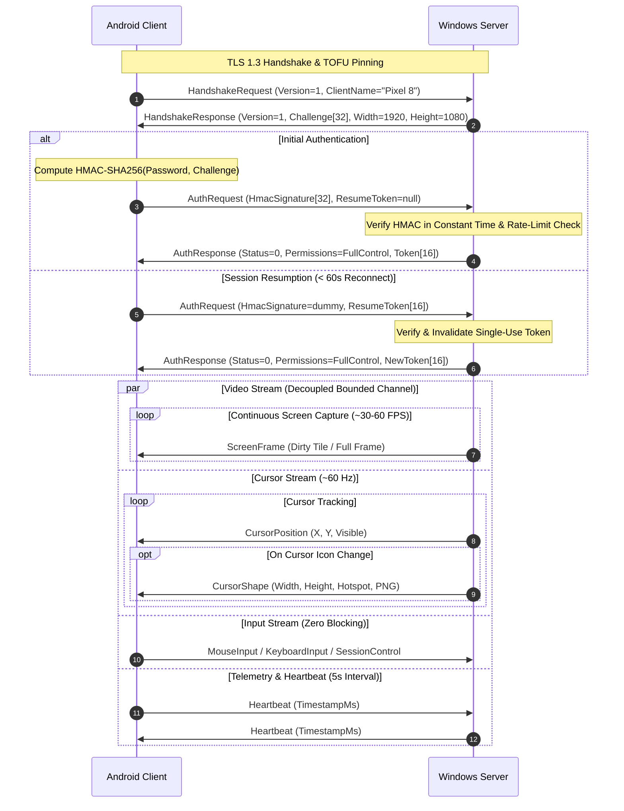

# ThanhVNC Wire Protocol Specification (v1.0)

## 1. Overview & Architectural Principles

ThanhVNC uses a high-performance, contract-first, binary framing protocol optimized for low-latency interactive desktop streaming over TCP/TLS. The protocol prioritizes:
- **Zero Head-of-Line Blocking for Input**: Input and control messages are prioritized ahead of video frames via decoupled channel queues.
- **Bounded Queues**: Frame delivery uses a bounded buffer (`Capacity = 1`, `DropOldest`), guaranteeing that stale video frames are discarded immediately under network congestion.
- **Strong Security by Default**: Native TLS 1.3/1.2 end-to-end encryption with SHA-256 certificate fingerprint pinning (TOFU), PBKDF2 password hashing, and HMAC-SHA256 challenge-response mutual verification.
- **Network Resilience**: 60-second single-use cryptographic session resumption tokens allowing instant reconnection without re-prompting user credentials.

---

## 2. Packet Framing Format

Every ThanhVNC packet consists of a **10-byte fixed-size header** followed by a variable-length payload. All multi-byte integers are serialized in **Little-Endian** byte order.

```
 0                   1                   2                   3
 0 1 2 3 4 5 6 7 8 9 0 1 2 3 4 5 6 7 8 9 0 1 2 3 4 5 6 7 8 9 0 1
+-+-+-+-+-+-+-+-+-+-+-+-+-+-+-+-+-+-+-+-+-+-+-+-+-+-+-+-+-+-+-+-+
|                       Magic: 0x434E5654                       | ('TVNC')
+-+-+-+-+-+-+-+-+-+-+-+-+-+-+-+-+-+-+-+-+-+-+-+-+-+-+-+-+-+-+-+-+
|    Version    |  MessageType  |         Payload Length        |
+-+-+-+-+-+-+-+-+-+-+-+-+-+-+-+-+-+-+-+-+-+-+-+-+-+-+-+-+-+-+-+-+
| (Payload Len) |               Variable Payload...             |
+-+-+-+-+-+-+-+-+                                               |
```

### Header Fields

| Field | Type | Size | Description |
|---|---|---|---|
| `Magic` | UInt32 (LE) | 4 bytes | Protocol identifier: `0x434E5654` (ASCII `"TVNC"`). |
| `Version` | UInt8 | 1 byte | Protocol version (current: `1`). |
| `MessageType` | UInt8 | 1 byte | Identifies the payload record type (1 to 15). |
| `PayloadLength`| Int32 (LE) | 4 bytes | Length of the subsequent payload in bytes (`0` to `16,777,216`). |

---

## 3. Message Types & Binary Payloads

### Type 1: `HandshakeRequest` (Client → Server)
Initiates protocol negotiation.

| Offset | Field | Type | Description |
|---|---|---|---|
| 0 | `Version` | UInt8 | Client protocol version. |
| 1 | `NameLength` | Int32 (LE) | Length of client name in UTF-8 bytes. |
| 5 | `ClientName` | Bytes | Client device name (e.g. `"Pixel 8 Pro"`). |

---

### Type 2: `HandshakeResponse` (Server → Client)
Provides server authentication challenge and initial desktop dimensions.

| Offset | Field | Type | Description |
|---|---|---|---|
| 0 | `Version` | UInt8 | Server protocol version. |
| 1 | `ChallengeLen` | Int32 (LE) | Length of challenge nonce (default: 32 bytes). |
| 5 | `Challenge` | Bytes | Cryptographically secure random challenge. |
| 5+L | `ScreenWidth` | Int32 (LE) | Remote desktop virtual screen width in pixels. |
| 9+L | `ScreenHeight` | Int32 (LE) | Remote desktop virtual screen height in pixels. |

---

### Type 3: `AuthRequest` (Client → Server)
Presents either an HMAC-SHA256 signature or a cryptographic session resumption token.

| Offset | Field | Type | Description |
|---|---|---|---|
| 0 | `SignatureLen` | Int32 (LE) | Length of HMAC-SHA256 signature (32 bytes). |
| 4 | `HmacSignature`| Bytes | `HMAC-SHA256(password, challenge)`. |
| 36 | `ResumeTokenLen`| Int32 (LE) | Length of optional resume token (`0` if none, `16` if resuming). |
| 40 | `ResumeToken` | Bytes | 16-byte cryptographically secure session resumption token. |

---

### Type 4: `AuthResponse` (Server → Client)
Returns authentication result, granted permissions, and new session resumption token.

| Offset | Field | Type | Description |
|---|---|---|---|
| 0 | `StatusCode` | UInt8 | `0` = Success, `1` = InvalidCredentials, `2` = ProtocolError, `3` = LockedOut. |
| 1 | `Permissions` | UInt8 (Bitmask)| Bit 0: ViewOnly, Bit 1: InputControl, Bit 2: ClipboardSync, Bit 3: FileTransfer. |
| 2 | `TokenLen` | Int32 (LE) | Length of new resumption token (`0` or `16`). |
| 6 | `SessionToken` | Bytes | 16-byte single-use session resumption token (60-second TTL). |

---

### Type 5: `ScreenFrame` (Server → Client)
Transmits desktop display tiles or full frames.

| Offset | Field | Type | Description |
|---|---|---|---|
| 0 | `FrameIndex` | UInt32 (LE) | Monotonically increasing frame sequence counter. |
| 4 | `TimestampMs`| Int64 (LE) | Capture timestamp in server system milliseconds. |
| 12 | `X` | Int32 (LE) | Bounding box X coordinate of updated region. |
| 16 | `Y` | Int32 (LE) | Bounding box Y coordinate of updated region. |
| 20 | `Width` | Int32 (LE) | Width of updated region in pixels. |
| 24 | `Height` | Int32 (LE) | Height of updated region in pixels. |
| 28 | `Format` | UInt8 | Compression codec: `1` = JPEG (Standard / DXGI Hardware Tile). |
| 29 | `Data` | Bytes | Compressed image bytes. |

---

### Type 6: `MouseInput` (Client → Server)
Transmits remote mouse position, button clicks, and scroll wheel events.

| Offset | Field | Type | Description |
|---|---|---|---|
| 0 | `Flags` | UInt16 (LE) | Bitmask: `Move=1`, `LeftDown=2`, `LeftUp=4`, `RightDown=8`, `RightUp=16`, `MiddleDown=32`, `MiddleUp=64`, `Wheel=128`. |
| 2 | `X` | Int32 (LE) | Target desktop X coordinate in pixels (`0` to `VirtualWidth-1`). |
| 6 | `Y` | Int32 (LE) | Target desktop Y coordinate in pixels (`0` to `VirtualHeight-1`). |
| 10 | `WheelDelta`| Int16 (LE) | Scroll delta (typically `+120` = Up, `-120` = Down). |

---

### Type 7: `KeyboardInput` (Client → Server)
Transmits keyboard keystrokes, modifier flags, and Unicode characters.

| Offset | Field | Type | Description |
|---|---|---|---|
| 0 | `Flags` | UInt16 (LE) | Bitmask: `KeyDown=1`, `KeyUp=2`, `ExtendedKey=4`, `Unicode=8`. |
| 2 | `VirtualKey` | UInt16 (LE) | Windows Virtual Key code (`0` when `Unicode` flag is set). |
| 4 | `ScanCode` | UInt16 (LE) | Hardware scan code or UTF-16 code unit (for Vietnamese IME). |

---

### Type 8: `Heartbeat` (Bidirectional)
Keeps socket alive and calculates live round-trip time (RTT).

| Offset | Field | Type | Description |
|---|---|---|---|
| 0 | `TimestampMs`| Int64 (LE) | Sender millisecond clock timestamp. Receiver echoes back immediately. |

---

### Type 9: `Disconnect` (Bidirectional)
Signals graceful session termination and invalidates session resumption tokens.

| Offset | Field | Type | Description |
|---|---|---|---|
| 0 | `ReasonCode` | UInt8 | Reason: `0` = UserRequested, `1` = ServerShutdown, `2` = InactivityTimeout. |

---

### Type 10: `QualityControl` (Client → Server)
Dynamically negotiates JPEG quality factor, target frame rate, and streaming preset.

| Offset | Field | Type | Description |
|---|---|---|---|
| 0 | `Quality` | UInt8 | JPEG quality percentage (`10` to `100`). |
| 1 | `TargetFps` | UInt8 | Target frame rate (`5` to `60` FPS). |
| 2 | `Preset` | UInt8 | `0` = Balanced, `1` = LowLatency, `2` = HighQuality. |

---

### Type 11: `ClipboardText` (Bidirectional)
Synchronizes text clipboard contents across client and server.

| Offset | Field | Type | Description |
|---|---|---|---|
| 0 | `Text` | UTF-8 Bytes | Clipboard plain text payload (maximum 1 MB). |

---

### Type 12: `AudioFrame` (Server → Client)
Transmits low-latency remote audio packets.

| Offset | Field | Type | Description |
|---|---|---|---|
| 0 | `TimestampMs`| UInt32 (LE) | Audio stream sample timestamp. |
| 4 | `SampleRate` | UInt16 (LE) | Sample rate in Hz (e.g. `48000`). |
| 6 | `Channels` | UInt8 | Number of channels (`1` = Mono, `2` = Stereo). |
| 7 | `Codec` | UInt8 | Codec identifier (`1` = Raw PCM16, `2` = Opus). |
| 8 | `Data` | Bytes | Audio payload bytes. |

---

### Type 13: `CursorPosition` (Server → Client)
Transmits remote Windows mouse cursor coordinates and visibility state (~60 Hz).

| Offset | Field | Type | Description |
|---|---|---|---|
| 0 | `X` | Int32 (LE) | Framebuffer relative X coordinate. |
| 4 | `Y` | Int32 (LE) | Framebuffer relative Y coordinate. |
| 8 | `Visible` | UInt8 | `1` = Cursor visible, `0` = Cursor hidden. |

---

### Type 14: `CursorShape` (Server → Client)
Transmits remote mouse cursor bitmap, dimensions, and active click hotspot.

| Offset | Field | Type | Description |
|---|---|---|---|
| 0 | `Width` | Int32 (LE) | Cursor bitmap width in pixels. |
| 4 | `Height` | Int32 (LE) | Cursor bitmap height in pixels. |
| 8 | `HotspotX`| Int32 (LE) | Horizontal pixel offset of active click point. |
| 12 | `HotspotY`| Int32 (LE) | Vertical pixel offset of active click point. |
| 16 | `Format` | UInt8 | `1` = PNG compressed, `2` = Raw BGRA32. |
| 17 | `Data` | Bytes | Cursor graphic bytes. |

---

### Type 15: `SessionControl` (Client → Server)
Executes administrative workstation actions and system shortcuts.

| Offset | Field | Type | Description |
|---|---|---|---|
| 0 | `Action` | UInt8 | Action: `1` = Lock, `2` = LogOff, `3` = Reboot, `4` = Shutdown, `5` = KeyCombo, `6` = SwitchMonitor. |
| 1 | `Parameter` | UInt32 (LE) | For `KeyCombo`: `1`=CtrlAltDel, `2`=WinD, `3`=WinX, `4`=AltTab, `5`=CtrlEsc, `6`=CtrlShiftEsc. For `SwitchMonitor`: Monitor index. |

---

## 4. Connection & Authentication Handshake


